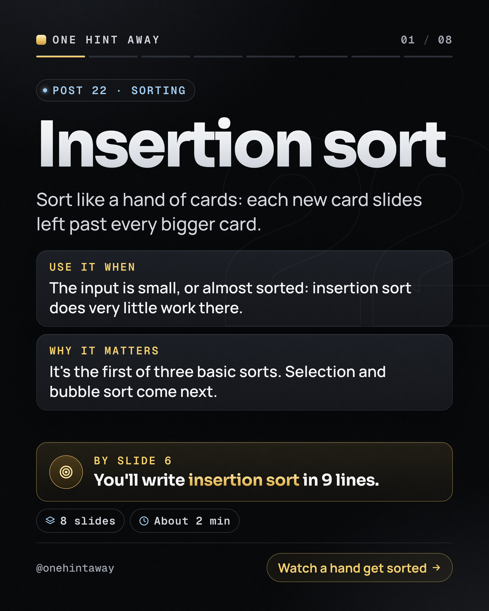
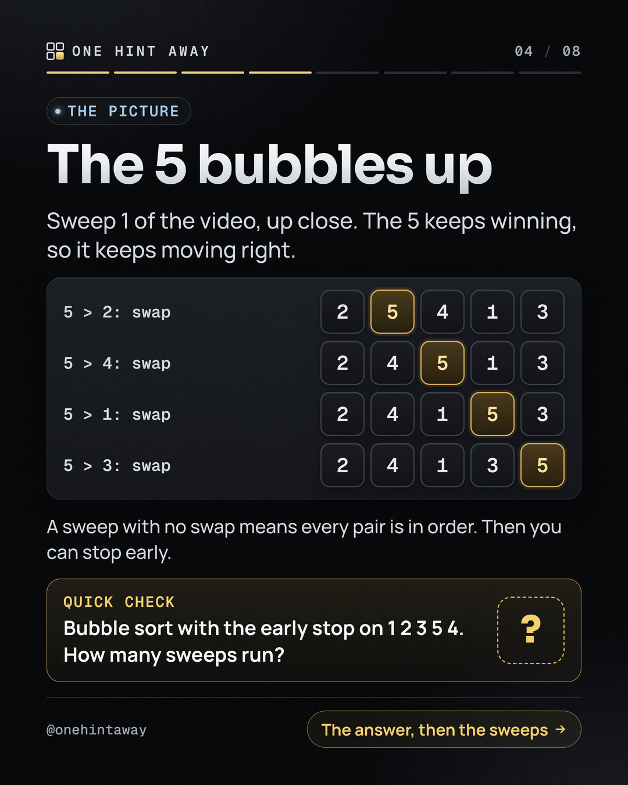
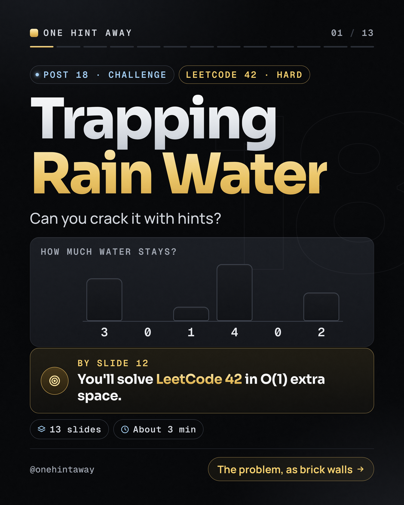
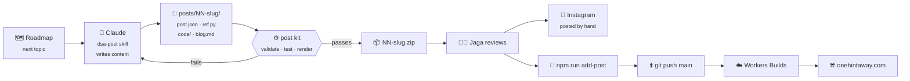
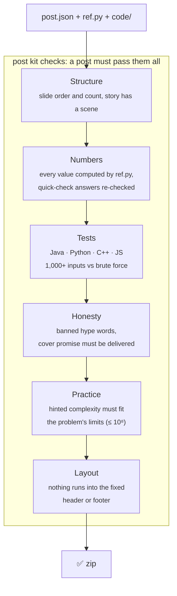
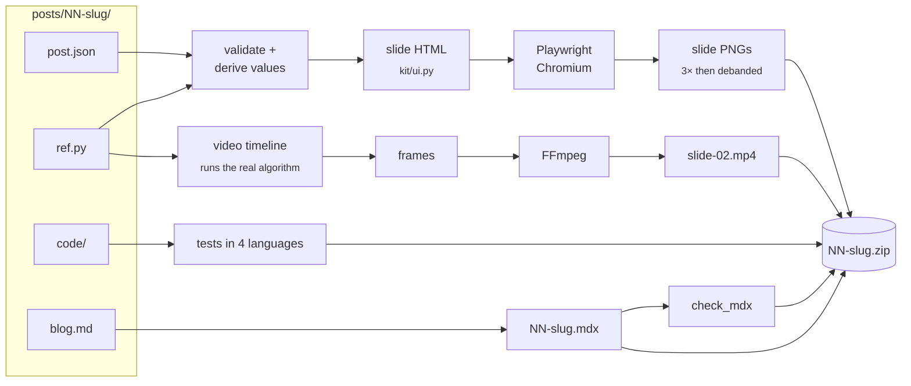

<div align="center">


# One Hint Away

### DSA patterns, one hint at a time.

Daily Instagram carousels and a companion blog that teach data structures and algorithms through a story, a picture, a motion video and pseudocode: **in that order, never code first.**

<br/>

[](https://onehintaway.com)
[](https://www.instagram.com/onehintaway/)


<br/>

&nbsp;
&nbsp;


<sub>Real slides from posts 22, 24 and 18, rendered by the post kit in this repo.</sub>

</div>

<br/>

## ✦ Contents

- [What this is](#-what-this-is)
- [How a post is born](#-how-a-post-is-born)
- [Where AI is used, and where it isn't](#-where-ai-is-used-and-where-it-isnt)
- [Guardrails: why AI mistakes don't reach a slide](#-guardrails-why-ai-mistakes-dont-reach-a-slide)
- [Repository map](#-repository-map)
- [The post kit](#-the-post-kit-post-kit)
- [The blog](#-the-blog-site)
- [The API](#-the-api-api)
- [Docker](#-docker)
- [Kubernetes and production](#-kubernetes-and-production)
- [Anatomy of a post](#-anatomy-of-a-post)
- [Run it locally](#-run-it-locally)
- [Design system](#-design-system)
- [Roadmap](#-roadmap)
- 🎓 [Learn the whole project, top to bottom](docs/learn/README.md)

<br/>

## ◆ What this is

One Hint Away is a faceless DSA page for total beginners who swipe fast. Every post teaches **one pattern** with **one tiny example** (five or six values) carried through the whole carousel, and ends with real LeetCode practice.

This monorepo holds the two machines behind it:

| | What it does | Built with |
| --- | --- | --- |
| **`post-kit/`** | Turns one content file per post into finished slides, a motion video, a blog page, a caption and alt text, after testing the post's code in four languages | Python, Playwright, FFmpeg, OpenCV, Node |
| **`site/`** | The blog at [onehintaway.com](https://onehintaway.com): every post as a page with its slides, video, pseudocode and tested code in Java, Python, C++ and JavaScript | Next.js 16, React 19, MDX, Shiki, Cloudflare Workers |

<br/>

## ◆ How a post is born



1. **Plan.** Posts follow a fixed roadmap (Foundations → Arrays and hashing → Maths → Recursion and sorting → Binary search → … → Dynamic programming), ten posts per batch.
2. **Write.** Claude, guided by a custom skill, writes the *content* of each post: the story, the picture, the hints, the pseudocode, the trap, the practice picks, and the reference code.
3. **Build.** The post kit (plain deterministic code, no AI) validates the content, runs every code file against a brute force on 1,000+ inputs, renders the slides and the video, and zips it all.
4. **Review and publish.** Jaga reads a plain-text summary of each post, checks the slides, posts to Instagram himself, and adds the post to the blog with one command. A push to `main` deploys the site.

<br/>

## ◆ Where AI is used, and where it isn't

AI does the drafting. Code does the checking and the rendering. A human decides what goes out.

| Step | Who | Details |
| --- | --- | --- |
| Pick the topic | Roadmap | A fixed, ordered list of patterns; nothing is improvised |
| Story, picture, hints, trap, caption | **Claude** | Written to strict teaching rules: story first, one idea per slide, no jargon before it's explained, no hype in hooks |
| Reference solution, brute force, test inputs | **Claude** | `ref.py`: the solution in Python, a brute force to check it, and the inputs to test with |
| Code in Java, Python, C++, JavaScript | **Claude** | `code/`: LeetCode-style solutions above a test harness |
| Every number on a slide | **Code** | Never typed: each `{{expression}}` in `post.json` is computed by running `ref.py` |
| Testing | **Code** | All four languages run on 1,000+ inputs and must match the brute force |
| Layout, fonts, header, footer, video | **Code** | The kit renders everything; the content file holds no HTML |
| Problem numbers and titles | **Claude + web** | Each practice problem's number, title, URL and difficulty is checked with a web search |
| Approve, post, deploy | **Jaga** | Nothing is published automatically, ever |

<details>
<summary><b>How Claude is guided (the skills)</b></summary>

<br/>

Claude works from two **skills**: versioned instruction files that hold the rules for this project.

- **`dsa-post`**: how to write a post. It covers the slide templates, the teaching rules, the pseudocode style (4-space indents, words not symbols, lines ≤ 44 characters), the honest-hook rule (no "most people", no "easy", no false promises on the cover), how to pick practice problems, and the exact shape of `post.json`, `ref.py` and `blog.md`.
- **`onehintaway-blog`**: how to build and run the site, its deploy steps, and the blog content contract both sides must follow.

A session goes like this: *"make the next 10 posts"* → Claude reads the roadmap, writes ten post folders, runs the kit until every check passes, and sends a plain-text review. Claude never writes slide HTML, video code or layout. The kit owns all of that, so every post looks the same however it was drafted.

</details>

<br/>

## ◆ Guardrails: why AI mistakes don't reach a slide

Language models make confident mistakes. Every rule below exists because one did, or could.



- **No typed numbers.** A slide saying "7 shifts" is really `{{insertion_shifts(EXAMPLE)}}`, so changing the example changes every slide, the video, the caption and the blog page together.
- **The trap is real.** Each post's "common mistake" is run as code: the wrong and the right result shown side by side both come from `ref.py`.
- **Four languages, one truth.** The pseudocode is a line-by-line translation of tested code; the blog shows the same tested code.
- **Visual rules are code too.** Fonts are embedded in every render, the header and footer are pinned, and the render fails if content overlaps them, if text is cut off, or if a box style would hide a value.
- **A human gate.** The kit can say a post is *correct*; only Jaga decides it's *good*.

<br/>

## ◆ Repository map

```text
OneHintAway-Blog/
├── post-kit/                     ⚙️  content → slides, video, blog page, zip
│   ├── render.py                 the one command
│   ├── kit/
│   │   ├── post.py               templates, derived values, validator, review summary
│   │   ├── ui.py                 the design system: header, footer, boxes, bars, code, cards
│   │   ├── video.py              motion slide: timeline → frames → MP4
│   │   └── blog.py               blog MDX + the four-language test runner
│   ├── tools/
│   │   ├── deband.py             removes colour banding from gradients on final export
│   │   └── check_mdx.mjs         checks the blog page against the content contract
│   ├── fonts/                    Sora · Manrope · Geist Mono (SIL OFL), embedded in renders
│   ├── posts/NN-slug/            one folder per post (written by Claude)
│   │   ├── post.json             the slides, caption and blog fields
│   │   ├── ref.py                reference solution, brute force, every number, test inputs
│   │   ├── code/                 Main.java · main.py · main.cpp · main.js
│   │   └── blog.md               the blog page body
│   ├── used_problems.json        practice problems already used, so none repeat
│   ├── viz/<pattern>/ref.py      reference code for the website's visualizer (brute force, 1,000+ inputs)
│   └── README.md                 step-by-step guide to running the kit
│
└── site/                         🌐  onehintaway.com
    ├── app/                      pages: home, posts/[slug], patterns, visualize, about, sitemap, robots
    ├── components/               SlideGallery, CodeTabs, Visualizer, PostList, PatternNav, ThemeToggle …
    ├── content/posts/            one .mdx per post
    ├── public/posts/NN/          each post's slides and video
    ├── lib/
    │   ├── posts.ts              reads every post's frontmatter at build time
    │   ├── api.ts                the only door to the API: empty address = every extra off, no call ever throws
    │   ├── sections.ts           roadmap sections, in reading order
    │   ├── remark-code-tabs.mjs  turns four language sections into one tabbed block
    │   └── shiki/                IntelliJ Light theme + a grammar for the pseudocode
    ├── visualizer/               the interactive pattern player's engine
    │   ├── schema.ts             the step format (v1) and the rules every step must obey
    │   ├── patterns/             one pure TypeScript generator per pattern, no DOM
    │   ├── registry.ts           the list the build checks · loaders.ts: one browser chunk per pattern
    │   ├── access.ts             free and paid tiers (the paywall switch, off for now)
    │   └── fixtures/             test inputs and brute-force answers, written by the post kit
    ├── scripts/
    │   ├── add-post.mjs          adds a finished post: MDX in, slides and video in, checked
    │   ├── check-posts.mjs       runs before every build; a drifting post fails the build
    │   ├── check-visualizer.mjs  runs before every build; one wrong step fails the build
    │   └── export-posts.mjs      writes the list of posts the API searches, and sends it (sync-posts)
    ├── Dockerfile                builds the site in a container (for CI; Cloudflare still serves it)
    └── wrangler.jsonc            Cloudflare: serve out/ as static files

api/                              ☕  Spring Boot API: view counts, copy counts, search, sign-ups
├── src/main/java/com/onehintaway/api/
│   ├── config/                   typed settings (the app won't start without its secrets), CORS
│   ├── visitor/                  the anonymous visitor id and the rate limiter
│   ├── posts/                    the posts table, the sync endpoint, search
│   ├── stats/                    view and copy counters
│   ├── accounts/                 sign-in by emailed code, sessions, CSRF check, progress
│   └── subscribers/              newsletter sign-up with double opt-in
├── src/main/resources/
│   ├── application.properties    every setting, each read from an environment variable
│   └── db/migration/             Flyway SQL: the only place the schema is defined
├── src/test/                     every endpoint against a real PostgreSQL 16 in Docker
├── Dockerfile                    the API image: build with a JDK, run on a small JRE, as a non-root user
├── .dockerignore                 lets only the build's four inputs reach Docker
├── compose.yaml                  Postgres alone, for running the API from the IDE
├── .env.example                  the settings to fill in (the real .env is git-ignored)
└── README.md                     run, test, build the image, settings, adding a migration

deploy/                           🐳  running it all together
├── compose/
│   ├── docker-compose.yml        the whole stack: API + PostgreSQL 16 + Umami, one private network
│   ├── postgres-init/            runs once on an empty volume: Umami's own database and user
│   └── .env.example              the settings to fill in (the real .env is git-ignored)
├── helm/onehintaway/             ☸️  the Helm chart: one description of the backend for laptop and server
│   ├── templates/                API, PostgreSQL, Umami, ingress, nightly backup
│   ├── values.yaml               defaults · values-local.yaml (k3d) · values-production.yaml (server)
├── server/                       one-time server setup: hardening, k3s, issuer + deploy account, monitoring
├── scripts/create-secret.sh      makes the chart's Secret from a git-ignored env file
├── README.md                     the runbook: deploy, roll back, back up, restore, rebuild
└── LEARN.md                      moved: points to docs/learn/

docs/learn/                       🎓  the course: this whole project, top to bottom, one chapter at a time

.github/workflows/api.yml         test → build image → push to GHCR → helm upgrade on the cluster
.github/workflows/sync-posts.yml  copies the posts into the API when a post changes
```

<br/>

## ◆ The post kit (`post-kit/`)

One command turns one folder into a finished post.



- **Slides** are HTML built from a small set of parts (boxes, bars, step rows, code blocks, cards), rendered by headless Chromium at 3× and scaled down after a debanding pass, so dark gradients stay smooth on phones.
- **The video** isn't animated by hand. `ref.py` runs the real algorithm and emits a list of states (swap, move, highlight, pointer, caption). The kit tweens between them, captions change as the boxes move, and frames that don't change are reused (often about 40%) before FFmpeg encodes the MP4.
- **The blog page** is generated from `blog.md` with the computed numbers filled in, the pseudocode from the slides, and the four tested code files, then checked against the contract the site enforces.

```bash
# check a post and render review PNGs
python3 post-kit/render.py post-kit/posts/24-bubble-sort --test --png review

# export the finished zip, dated for posting
python3 post-kit/render.py post-kit/posts/24-bubble-sort --export --start 2026-11-09

# a whole batch, one post a day
python3 post-kit/render.py post-kit/posts/2[4-9]-* --export --start 2026-11-07 --daily
```

Full setup (WSL, packages, troubleshooting): **[post-kit/README.md](post-kit/README.md)**.

<br/>

## ◆ The blog (`site/`)

A fully static site: Next.js builds plain HTML, CSS and JS into `out/`, and Cloudflare serves it from its edge with no server and no Worker code.

| Feature | How |
| --- | --- |
| Posts written in MDX | `@next/mdx` with `remark-frontmatter` and `remark-gfm` |
| Code in four languages, one block | `lib/remark-code-tabs.mjs` turns `## Java … ## JavaScript` sections into `<CodeTabs>` |
| Syntax colours with zero client JS | Shiki at build time: VS Code Dark+ for dark mode, IntelliJ Light for light mode |
| Pseudocode highlighted too | A custom TextMate grammar (`lib/shiki/pseudo.tmLanguage.json`) for the series' pseudocode style |
| Slides and video on every post | `SlideGallery` with full-screen view |
| Step through a pattern on your own input | `/visualize/` and a player on matching posts: play, step, scrub, speed, the running pseudocode line, keyboard and screen-reader support. Algorithms run in the reader's browser; no server, no AI |
| A visualizer step can't be wrong | `scripts/check-visualizer.mjs` runs as `prebuild`: every pattern must agree with a Python brute force on 1,000+ inputs, and every step of every input is checked |
| Browse by roadmap or pattern | `lib/sections.ts` order and a patterns index |
| Light and dark themes | `ThemeToggle`, no flash on load |
| SEO | Generated `sitemap.xml` and `robots.txt` |
| A post can't drift from the format | `scripts/check-posts.mjs` runs as `prebuild`: sections, code languages, practice links, file sizes and video sizes are checked, and a bad post fails the build |

```bash
cd site
npm install
npm run dev                                   # http://localhost:3000

npm run add-post -- 24-bubble-sort/24-bubble-sort.mdx 24-bubble-sort/
npm run build                                 # runs check-posts and check-viz first, then builds out/
npm run check-viz -- --sample 50              # quick visualizer check while working
npm run viz-fixtures                          # after changing post-kit/viz/*/ref.py (needs Python)
```

### The pattern visualizer

Readers step through an algorithm on their own numbers at [`/visualize/`](https://onehintaway.com/visualize/): a gallery with one page per pattern, and the same player on any post whose frontmatter says `visualizer: <pattern>`.

| Piece | What it does |
| --- | --- |
| `visualizer/patterns/<id>.ts` | The algorithm as a generator that yields one step at a time: a list of typed pictures (array with pointers and a window, stack, tree, map, bars, grid, linked list), named values, one sentence of narration and the pseudocode line. No DOM. |
| `components/VisualizerPlayer.tsx` | Draws any pattern's steps. Motion is CSS transforms only. One-screen layout: input on top, picture left, pseudocode right scrolling in its own box; tabs on phones. |
| `post-kit/viz/<id>/ref.py` | The same algorithm in Python with a brute force and 1,000+ test inputs. `npm run viz-fixtures` saves its answers, so the cloud build never needs Python. |
| `scripts/check-visualizer.mjs` | Fails the build unless TypeScript and Python agree on every input, every step obeys the schema and the pattern's own rules, the example's trace matches step for step, and the pseudocode equals the post's. |

Each pattern ships as its own small chunk (about 2 KB gzipped) beside the player (about 4 KB), loaded only on pages that show one; a post without a player carries only a few hundred bytes for it (`components/VisualizerSlot.tsx`). Patterns today: 35, from two pointers to fast and slow pointers (`visualizer/registry.ts` is the list). Seven kinds of picture: array, stack, tree (a binary-search tree lined up with the array, or a compact decision tree for backtracking), map, bars, grid and linked list (arrows that turn or loop back, pointers that can stand on none). Adding one is two files and two list entries: see [`post-kit/README.md`](post-kit/README.md#website-visualizer-step-by-step).

**Sign in to play (when accounts are on, as on the live site).** With `NEXT_PUBLIC_ACCOUNTS=on`, the player plays only for a signed-in reader, on every pattern, free or paid. A signed-out reader still gets the title, the problem, the one-line idea and the pseudocode, all in the built HTML, and in place of the player a card, "Sign in to try it on your own input", with a Sign in button that opens the header's sign-in panel. After the code is typed in, the card turns into the player on the same page with no reload, and other open tabs follow. In the gallery, each card shows a small padlock in its corner (the same mark can later stand for a paid pattern). Signed-out readers never download the player or pattern chunks. The gate fails open: if the API is down or the sign-in check gets no answer within its 8-second timeout, the player shows. While the check runs, the space is kept at about the player's height and the card is not shown. The rule is one function, `canPlay()` in `visualizer/access.ts`, which then applies the free and paid tiers as before (`PAYWALL_ON` is still off). With accounts off, the visualizer is built exactly as before.

> [!NOTE]
> This gate is a reason to sign up, not protection. It works only in the browser: the player and pattern chunks are public static files, and anyone can fetch them or change the page's script. Keeping paid patterns from non-paying readers needs a server check (see the paywall plan).

**Deploy:** a push to `main` triggers **Cloudflare Workers Builds** (root directory `site`), which builds and publishes `out/` to [onehintaway.com](https://onehintaway.com).

<br/>

## ◆ The API (`api/`)

A small Spring Boot 4.1 service (Java 21) with PostgreSQL 16. It adds the things a static site can't do alone: count views and code copies, search the posts, take newsletter sign-ups, and keep reader accounts with their progress. **It is live at `api.onehintaway.com`** since 16 November 2026, on a one-server Kubernetes cluster ([how](#-kubernetes-and-production)). The site reads its address from one build setting; built without it, the pages are exactly what they were before the API existed.

| Method and path | What it does | Answers |
| --- | --- | --- |
| `POST /api/v1/posts/{slug}/views` | Counts a view, once per visitor per day | 204 |
| `POST /api/v1/posts/{slug}/copies?lang=java` | Counts one copy of a code block, by language | 204 |
| `GET /api/v1/posts/{slug}/stats` | Views, copies, copies by language | JSON |
| `GET /api/v1/search?q=` | Searches titles, patterns and page text; best 20, best first | JSON list |
| `POST /api/v1/subscribers` | Starts a newsletter sign-up | 202 |
| `GET /api/v1/subscribers/confirm?token=` | The link in the confirmation email | redirect to the site |
| `POST /api/v1/subscribers/unsubscribe` | The page the email's Unsubscribe button opens posts the token | 204 |
| `GET`, `PUT`, `DELETE /api/v1/subscribers/me` | A signed-in reader's own subscription: read it, subscribe in one click (no confirmation email), unsubscribe | 200 · 204 · 204, 401 signed out |
| `POST /api/v1/auth/code` | Emails a 6-digit sign-in code (first time: registers). Body `{"email"}`; `{"purpose":"delete"}` when signed in, for the code that allows deleting the account | 202 |
| `POST /api/v1/auth/session` | Trades the code for a session cookie. Body `{"email", "code"}` | JSON, or 410 for a wrong, used, expired or dead code |
| `GET /api/v1/auth/me` | Who is signed in | JSON, or 401 |
| `POST /api/v1/auth/sign-out` | Ends this device's session | 204 |
| `POST /api/v1/auth/sign-out-everywhere` | Ends every session of this reader | 204 |
| `DELETE /api/v1/auth/account` | Removes the user, sessions and progress; needs a session under 15 minutes old | 204, or 403 |
| `GET /api/v1/progress` | The posts this reader marked as done | JSON |
| `PUT`, `DELETE /api/v1/progress/{slug}` | Marks a post as done, or not done | 204, 404 for an unknown post |
| `PUT /api/v1/admin/posts` | Replaces the posts table (called by the site's sync script, with a secret) | JSON |
| `GET /actuator/health/liveness`, `/readiness`, `/actuator/prometheus` | Kubernetes probes and metrics | |

### The rules it works by

**A visitor is a hash, never an address.** To count "one view per visitor per day" the API needs to tell visitors apart, but it must not keep anything that identifies a person. So it stores only SHA-256 of *(secret salt, today's date, IP address, browser name)*. The salt stops anyone with the database from testing addresses against it. The date is inside the hash, so the same reader gets a different id tomorrow and visits can't be joined up across days.

**The database does the counting.** A view is one `INSERT … ON CONFLICT DO NOTHING` into a table whose primary key is *(post, day, visitor)*: a second view from the same visitor simply hits the key. A copy is one `INSERT … ON CONFLICT DO UPDATE SET count = count + 1`. Nothing is read before it is written, so two requests at the same instant can't lose a count. Counts are only kept for posts the site has synced, so made-up addresses can't fill the tables.

**Every write is rate-limited**, with a token bucket (Bucket4j) per address and per kind of request: 60 counts a minute, 5 sign-ups an hour, 10 sync calls a minute. Over the limit, the answer is `429` with `Retry-After`. The limit is keyed on the address alone, not the browser name, because the caller chooses the browser name and could change it to get a fresh allowance. Buckets live in memory, which is right for one instance; two replicas would each allow the full limit.

**Search is PostgreSQL full-text search.** Each post has a `tsvector` column that Postgres works out itself from the title (heaviest), the pattern and the page text, so it can never be out of date. Full-text search only matches whole words, so a half-typed word would find nothing; a second condition (`ILIKE` on title and pattern) makes search-as-you-type work.

**The posts table is a copy, and the MDX files stay the truth.** `npm run sync-posts` in `site/` reads every post's frontmatter and its text without code, and sends the whole list in one `PUT`. In one transaction the API saves every post in the list and deletes the ones missing from it; an empty list is refused, so a broken export can't wipe the table. The caller proves itself with a shared secret, compared in constant time. View and copy history has no foreign key to posts, so removing a post never deletes its numbers.

**A sign-up only counts after the email link is opened** (double opt-in). Signing up stores the address as `PENDING` with a random 32-byte token and emails a link holding that token; opening it sets `CONFIRMED`. So nobody can subscribe someone else, and the list only holds addresses that work. The answer to a sign-up is always the same `202`, whether or not the address was already known, so the form can't be used to find out who is subscribed. The email goes out through [Resend](https://resend.com)'s HTTP API when a key is set; without one (local runs) the link is written to the log instead. Both sit behind one `MailSender` interface. If Resend refuses the email, the sign-up fails with a `503` and nothing is stored, so nobody is left pending with no email on the way. The email asks one question, "Get new patterns by email?", with a **Yes, subscribe me** button and a short "what you get" box; the link lands on the site's `/subscribed/` page. An address that is already subscribed gets a note instead, with an **Unsubscribe** button that opens `/unsubscribe/` (the page posts the token; unsubscribing deletes the row). A signed-in reader skips the email: one click subscribes or unsubscribes their own address, which the sign-in code already proved. Nothing is sent to the list yet: whether to run a newsletter (the plan was Listmonk on the cluster, sending through Amazon SES) is decided once there are subscriber numbers.

**Only the site's pages may call it from a browser** (CORS limited to the site's address), every input is validated (bad input is a `400` with a problem-JSON body), and the schema changes only through numbered Flyway migrations; Hibernate just checks that the code matches it.

### Accounts: sign in by emailed code

A reader can make an account to keep track of finished lessons. Reading never needs one.

**There are no passwords.** A password is a secret this small site would have to store, protect, reset and one day leak; and most people reuse theirs. Instead, the reader types an email address and the API emails a 6-digit code. Typing it on the site proves the address is theirs, which is all a password reset would ask anyway. Register and sign in are the same flow: the first sign-in creates the account, and there is one account per email address.

**The code.** Six random digits that work once and for 15 minutes, for that address only; the database stores only the SHA-256 of `email:code`. A code is short enough to guess, so every wrong try counts against the address's live codes and five wrong tries kill them: five guesses in a million, and at most three codes an hour per address.

**No link in the email, on purpose.** The reader types the code in the same panel and stays on the page. Company mail filters that open every link in an email (some even run the page's script) can't use a code up, and the reader is signed in in the browser they are using, not in a mail app's small built-in one.

**The answer never says who has an account.** Asking for a code is always `202`, known address or not (both get an email: one signs in, the other registers). Requests are limited per caller (10 an hour, in memory) and per email address (3 an hour, counted in Postgres, so it holds across both replicas); over the per-email limit the API sends nothing and still answers `202`. Before any of that, the request must carry a **Cloudflare Turnstile** token that the API confirms with Cloudflare (`403` otherwise): every code is a real email, and without the check a script could use up the email allowance so real readers get none. Most readers never see it; a browser Cloudflare is unsure about gets one checkbox.

**Sessions live in Postgres**, because pods are replaced on every deploy (and the laptop cluster runs two), so nothing may live in one pod's memory. A session is another random 32-byte token, stored hashed, sent as a cookie that is `HttpOnly` (scripts can't read it), `Secure`, `SameSite=Lax`, named with the `__Host-` prefix (no other onehintaway.com address can set or overwrite it) and good for 30 days after its last use. **Sign out** deletes that one row; **sign out everywhere** deletes all of the reader's rows, so a copied cookie stops working the moment either is pressed.

**CSRF.** The site and the API are different origins but the same site, so the browser sends the cookie on the site's `fetch` calls (`credentials: "include"`), and CORS allows credentials for the exact site origin only. Every request that changes something on the account and progress paths must carry the site's `Origin` and a custom header, `X-OHW-CSRF`; anything else is `403`. That is enough here because browsers set `Origin` themselves, a form can't add a custom header, and a script that tries triggers a preflight that only the site's origin passes.

**Deleting the account** asks for a fresh emailed code first (sent only to the signed-in reader's own address), then a confirm button. The API allows it only for a session that began in the last 15 minutes, and removes the user, every session and all progress in one go.

**Progress** is one row per reader and finished post, only for posts the site has synced.

**Room for a second sign-in method.** `users` holds only the email, and `sessions` says nothing about how the reader signed in. Google sign-in would add one table (provider, Google's user id, `users.id`) and one endpoint that ends by creating the same kind of session; neither existing table changes.

**On the site** all of this is behind a second build setting, `NEXT_PUBLIC_ACCOUNTS=on`: a Sign in button in the header that opens the email-and-code panel (also at `/sign-in/`), an account menu, **Mark as done** on each post, ticks on the home and patterns lists, and a [privacy page](https://onehintaway.com/privacy/). A reader who has never signed in makes no account request at all; signed out, or with the API down, the pages are the same as without accounts, except the visualizer: signed out, it asks the reader to sign in ([details](#the-pattern-visualizer)); with the API down, it plays for everyone. Closing the sign-in panel (a tap outside it, Escape) keeps its step: opened again, or on `/sign-in/`, it is back at the code field until the code runs out after 15 minutes, even after a reload in the same tab (`lib/sign-in-draft.ts`, sessionStorage); the delete-account steps are kept the same way. Every open tab follows a sign-in or sign-out made in another tab of the same browser, and the header shows the reader's initial once signed in. The newsletter stays a separate list with its own form in the footer: signing in never subscribes anyone.

### How the site uses it, and how it fails

The site reads one build-time setting, `NEXT_PUBLIC_API_URL` (set in production). Empty, and nothing API-related is rendered or called. Set, and four things appear: a view count in each post's meta row, a search button in the header, a silent count when a reader copies code, and the "Get new patterns by email" form in the footer (`NEXT_PUBLIC_SIGNUP=off` hides that one).

Every call goes through [`site/lib/api.ts`](site/lib/api.ts), which gives up after four seconds and returns nothing instead of throwing. So with the API slow, failing or gone, a post page looks exactly like a page with no count, search says it isn't available right now, and no error reaches the screen.

### How it is tested

`./mvnw verify` starts a throwaway PostgreSQL 16 in Docker (Testcontainers), applies the real migrations and calls every endpoint: counting once per visitor, the stored hash holding no address, per-language copies, search by word and by half-typed title, the sync's token and delete rules, the whole double opt-in, the rate limit, CORS and the probes. Accounts have their own test class: the whole sign-in flow, expired, reused and wrong codes, a code for another address, a code dying after five wrong tries, a copied cookie after sign out and after sign out everywhere, session renewal, every CSRF refusal, progress, and deleting an account. GitHub Actions runs the same command on every push that touches `api/`.

<br/>

## ◆ Docker

Two images and one compose file. Together they start the API, its database and the analytics on any machine that has Docker, with one command and nothing else installed. Nothing is pushed to a registry yet, and the public site still comes from Cloudflare.

| Piece | What it is | Size |
| --- | --- | --- |
| [`api/Dockerfile`](api/Dockerfile) | The API image: Java 21 runtime on Alpine plus the app | 272 MB unpacked, 128 MB to download |
| [`site/Dockerfile`](site/Dockerfile) | The site build in a container; the result holds only the finished `out/` files | about 178 MB unpacked (mostly slides and videos) |
| [`deploy/compose/docker-compose.yml`](deploy/compose/docker-compose.yml) | API + PostgreSQL 16 + Umami on one private network | |

### Why the API image is built this way

**Three stages, one shipped.** The first stage has a full JDK and the Maven wrapper and produces the jar. The second splits the jar into parts. Only the third, a small JRE image, becomes the image: the compiler, Maven, the downloaded build plugins and the source code never leave the first stage.

**Layers ordered by how often they change.** Docker reuses a layer when its instruction and the files it copies are unchanged, and rebuilds everything after the first change. So `pom.xml` is copied and the dependencies downloaded *before* the source code is copied: a code-only change reuses that layer and downloads nothing (a rebuild takes about 18 seconds instead of 97). The same idea shapes the final image: Spring Boot's layered jar puts the libraries (60 MB) in one layer and the app's own classes (53 KB) in another, so a new version of the API is a 53 KB layer to push and pull.

**Not root.** The process runs as user `10001`, which owns nothing. A numeric id, not a name, so Kubernetes can enforce `runAsNonRoot` later.

**It reports its own health.** A `HEALTHCHECK` calls `/actuator/health/readiness`, the same endpoint Kubernetes will probe, so "healthy" means "connected to the database and ready for traffic", not "the process exists".

**Nothing secret, nothing extra.** [`api/.dockerignore`](api/.dockerignore) refuses everything and lets back in only the wrapper, `pom.xml` and `src/`, so `api/.env` can't reach an image layer even by mistake. Every setting arrives as an environment variable when the container starts. The tests don't run inside the image build (they need Docker themselves); CI runs them first.

### The stack

| Service | Image | Reachable from |
| --- | --- | --- |
| `api` | built from `api/` | this machine, `127.0.0.1:8080` |
| `postgres` | `postgres:16-alpine` | the other containers only |
| `umami` | `ghcr.io/umami-software/umami:3.5.0` | this machine, `127.0.0.1:3001` |

- **One network, names instead of addresses.** The API reaches the database at `postgres:5432`: Docker's DNS turns the service name into the container's address. The database publishes no port at all, and the two that do are bound to `127.0.0.1`, so nothing is open to the network the machine is on.
- **A named volume holds the data.** Containers are disposable; `pgdata` is not. `docker compose down` keeps it, `down -v` deletes it.
- **One Postgres, two databases.** A script that runs once on an empty volume creates a separate `umami` database with its own user, so the analytics can't read the blog's tables.
- **Order by health.** The API and Umami start only after Postgres answers `pg_isready`, and `up --wait` returns only when all three are healthy.
- **Config from one git-ignored file.** `deploy/compose/.env` holds the values; the compose file hands each container only the variables it needs and refuses to start if a required one is blank.
- **Every image tag names a version**, never `latest`, so the same file gives the same stack next month.

[`api/compose.yaml`](api/compose.yaml) stays as the database-only file for running the API from the IDE.

<br/>

## ◆ Kubernetes and production

The backend runs on one small cloud server (2 vCPU, 4 GB) with [k3s](https://k3s.io), a full Kubernetes in a single binary. A managed cluster would cost several times more and teach less. The site is not on it: readers get static files from Cloudflare, so if the server is down every post still loads and only the extras pause.

| Address | What answers | |
| --- | --- | --- |
| `api.onehintaway.com` | The API, one pod | only `/api` and `/actuator/health` are routed; metrics stay inside |
| `stats.onehintaway.com` | Umami analytics | cookie-free, self-hosted |
| `grafana.onehintaway.com` | Dashboards and alerts | behind a login; off until switched on, to save memory |

**One Helm chart, two places.** [`deploy/helm/onehintaway`](deploy/helm/onehintaway) describes the API, PostgreSQL, Umami, the ingress and the backup job once. `values-local.yaml` runs it on a k3d cluster on the laptop; `values-production.yaml` adds HTTPS, real hostnames and backups. What is tested locally is what ships.

**A deploy can't take the API down.** The rolling update has `maxSurge: 1` and `maxUnavailable: 0`: a new version starts beside the old one and takes traffic only when its readiness probe passes; only then is the old pod removed, after a 5-second pause so Traefik has stopped sending it requests (without it, a one-pod deploy measured ~2 s of 502s). Production runs one API pod since 20 November (two cost 300 MB on a 4 GB server); deploys still have no gap, but a crash of that pod means a restart's worth of downtime. If the new pods never become ready, Helm puts the previous release back by itself. This was tested with a deliberately broken image: the public address answered `200` throughout, and the rollback took 79 seconds.

**Three probes, three questions.** *Startup*: has the JVM finished booting? (up to 150 s, so a slow start is not mistaken for a hang). *Liveness*: is the process stuck? If so, restart it. *Readiness*: can it serve right now (database reachable)? If not, stop sending it requests, but don't restart it.

**PostgreSQL is a StatefulSet** with its own persistent volume: the pod keeps its name and its disk through restarts and upgrades. Every night a CronJob dumps both databases and copies them off the server to Cloudflare R2, keeping 14 days; the [runbook](deploy/README.md#backups) has the restore steps.

**Push to deploy.** [`api.yml`](.github/workflows/api.yml) runs the tests, builds the image, pushes it to GitHub's registry tagged with the commit SHA (never `latest`, so every running pod can be traced to its code and a rollback is just an older tag), then runs `helm upgrade`. It deploys with an account that can change one namespace and nothing else.

**Secrets never touch Git.** They are generated on the server and live in Kubernetes Secrets (encrypted at rest); the chart only names them. The server itself takes SSH keys only, has a firewall that leaves just SSH, web and the Kubernetes API open, and installs security updates by itself.

**HTTPS renews itself.** cert-manager asks Let's Encrypt for a certificate per hostname and renews it a month before expiry.

**Watching it.** Prometheus scrapes the API's metrics from inside the cluster, Grafana shows them when switched on, and two alerts are defined: no API pod answering, and less than 15% disk free. Kubernetes' own control-plane metrics are not kept: k3s exposed them twice, and they were 86% of Prometheus's memory. How that was found is in [chapter 13](docs/learn/13-operations.md#-the-memory-diet-20-november).

Day-to-day commands are in the runbook, [`deploy/README.md`](deploy/README.md); the course that teaches the whole project (frontend, backend, database, security, testing, Docker, Kubernetes, CI/CD, production and operations), with something to break on purpose in each chapter, is in [`docs/learn/`](docs/learn/README.md).

<br/>

## ◆ Anatomy of a post

<table>
<tr>
<th width="50%">📘 Concept post · 8 slides</th>
<th width="50%">🧩 Challenge post · 13 slides</th>
</tr>
<tr valign="top">
<td>

1. **Cover**: what you'll be able to do, and by which slide
2. **Video**: the algorithm moving on the tiny example
3. **Story**: an everyday scene that mirrors the idea
4. **Picture** + quick check
5. **Answer** + one more idea on the same numbers
6. **Template**: the pseudocode, highlighted
7. **Trap** + cost: a real beginner bug, wrong vs right
8. **Practice**: one easy and one medium LeetCode problem

</td>
<td>

1. **Cover** and the problem
2. **Story**: the problem as an everyday scene
3. **The real problem** (LeetCode number and example)
4. **Pause**: try it first
5–8. **Hint ladder**: restate → key observation → technique → exact condition
9. **Bridge**
10. **Video**
11–12. **Solution** in pseudocode, with cost
13. **Closing**: the pattern and what to practise next

</td>
</tr>
</table>

Every slide shares one fixed frame: a header with the logo, the slide count and a progress bar, and a footer with the handle and a pill teasing the next slide.

<br/>

## ◆ Run it locally

<details>
<summary><b>Site</b>: Node 22</summary>

```bash
cd site && npm install && npm run dev
```

On its own, the site has no view counts, search or sign-in: those need the API (next section). Posts, slides, code and the visualizer all work.

</details>

<details>
<summary><b>API</b>: JDK 21 or newer, Docker</summary>

```bash
cd api
cp .env.example .env            # then fill in the three blank values
docker compose up -d --wait     # PostgreSQL 16 on localhost
./mvnw spring-boot:run          # the API on http://localhost:8080

./mvnw verify                   # the tests; they start their own database
```

To see the site use it, in a second terminal:

```bash
cd site
cp .env.example .env.local      # once: points the site at http://localhost:8080 and turns accounts on
npm run sync-posts              # copy the posts into the API (needed for search and counts)
npm run dev                     # http://localhost:3000, with view counts, search and Sign in
```

`.env.local` is git-ignored and read every time `npm run dev` or `npm run build` starts, so **restart the dev server after changing it**. Without it the site quietly builds with no API: no search and no Sign in button. Production does not use the file; the same settings are Cloudflare build variables.

No email is sent locally: ask for a code on the site, then copy it from the API's log (`Sign-in code for …`) into the code field.

More in [api/README.md](api/README.md).

</details>

<details>
<summary><b>The whole stack in Docker</b>: Docker only, no JDK needed</summary>

```bash
cd deploy/compose
cp .env.example .env            # then fill in the five blank values (openssl rand -hex 32)
docker compose up -d --wait     # builds the API image, starts API + PostgreSQL + Umami

curl http://localhost:8080/actuator/health/readiness    # {"status":"UP"}
(cd ../../site && npm run sync-posts:compose)           # copy the posts into the API
```

The API is on `http://localhost:8080` and Umami on `http://localhost:3001` (first login `admin` / `umami`: change it). Stop with `docker compose down`; add `-v` to delete the database too.

To build the site in a container: `docker build -t onehintaway-site:local site`.

</details>

<details>
<summary><b>Post kit</b>: WSL / Linux / macOS</summary>

```bash
sudo apt install -y python3 python3-pip ffmpeg nodejs npm default-jdk g++
python3 -m pip install --break-system-packages playwright pillow numpy scipy opencv-python-headless fonttools brotli
python3 -m playwright install --with-deps chromium
(cd post-kit/tools && npm install)

python3 post-kit/render.py post-kit/posts/24-bubble-sort --test --png review
```

The JDK and `g++` are only needed for `--test`. The full step-by-step guide is in [post-kit/README.md](post-kit/README.md).

</details>

<br/>

## ◆ Design system

**Graphite & Chrome**: dark, quiet and readable on a phone in one glance.

| Token | Value | Used for |
| --- | --- | --- |
| Background | `#08090B` with two soft radial glows | every slide |
| Text | `#F5F6F8` · muted `#D3D7DE` · labels `#A2A8B3` | body, leads, labels |
| Gold | `#FFF0C2 → #EBC566 → #C99A3F` | the current pick, the answer, the next-slide pill |
| Steel | `#A3CDF2` | the done or sorted part, section pills |
| Headings | **Sora** 800 / 700 | covers at up to 150 px, titles at 92 px |
| Body | **Manrope** 500–700 | leads, cards, captions |
| Labels and code | **Geist Mono** 500–600 | pseudocode, box values, small caps labels |

Slides are 1080 × 1350 (Instagram 4:5) with 80 px side margins.

<br/>

## ◆ Roadmap

- [x] Post kit: content in, finished post out, tested in four languages
- [x] Blog live at [onehintaway.com](https://onehintaway.com) on Cloudflare Workers static assets
- [x] Posts 00–32 on the blog; batches of ten drafted ahead
- [x] Interactive pattern visualizer: 35 patterns, checked against a brute force on every build; with accounts on, it plays for signed-in readers (padlock on each gallery card)
- [x] Visualizer pictures: decision trees (binary search, subsets, permutations), moving cells for sorting, grid, map, bars, call stack, linked list
- [ ] Visualizer: heap and graph pictures (when the roadmap reaches them)
- [ ] Post kit: studio-quality pass on slides and video, with the video drawn from the visualizer's step format
- [x] **API**: Spring Boot 4.1 (Java 21) + PostgreSQL 16 for search, view counts and sign-ups: built and tested, live once the cluster exists
- [x] **Docker**: images for the API and the site build, and one compose file that starts the API, PostgreSQL and Umami with one command
- [x] **Cluster**: k3s on one server with Traefik, cert-manager, Umami analytics, Prometheus and Grafana; the API is live at `api.onehintaway.com`
- [x] **CI/CD**: a push to `main` tests the API, builds the image, pushes it to GHCR and rolls it out, with automatic rollback
- [x] **Operations**: nightly database backups to Cloudflare R2 (restore tested), Prometheus alerts, a runbook
- [x] An outside uptime check every 15 minutes, link-preview images and search titles on every post, the newsletter sign-up form in the footer, with a confirmation email through Resend
- [x] **Accounts**: sign in by emailed code (no passwords), sessions in Postgres, progress ticks, a privacy page: built, tested and live (`NEXT_PUBLIC_ACCOUNTS=on` in Workers Builds)
- [ ] Sign in with Google (the tables are ready for it)
- [ ] Newsletter (Listmonk + Amazon SES)

The site never depends on the cluster: if the API is down, every post still loads, and only the extras pause.

<br/>

<div align="center">

<sub>Made by <a href="https://github.com/jagapradeep">Jagapradeep G</a> · content drafted with Claude, checked by code, approved by a human · fonts under the SIL Open Font License</sub>

<br/>

**[onehintaway.com](https://onehintaway.com)** &nbsp;·&nbsp; **[@onehintaway](https://www.instagram.com/onehintaway/)**

</div>
