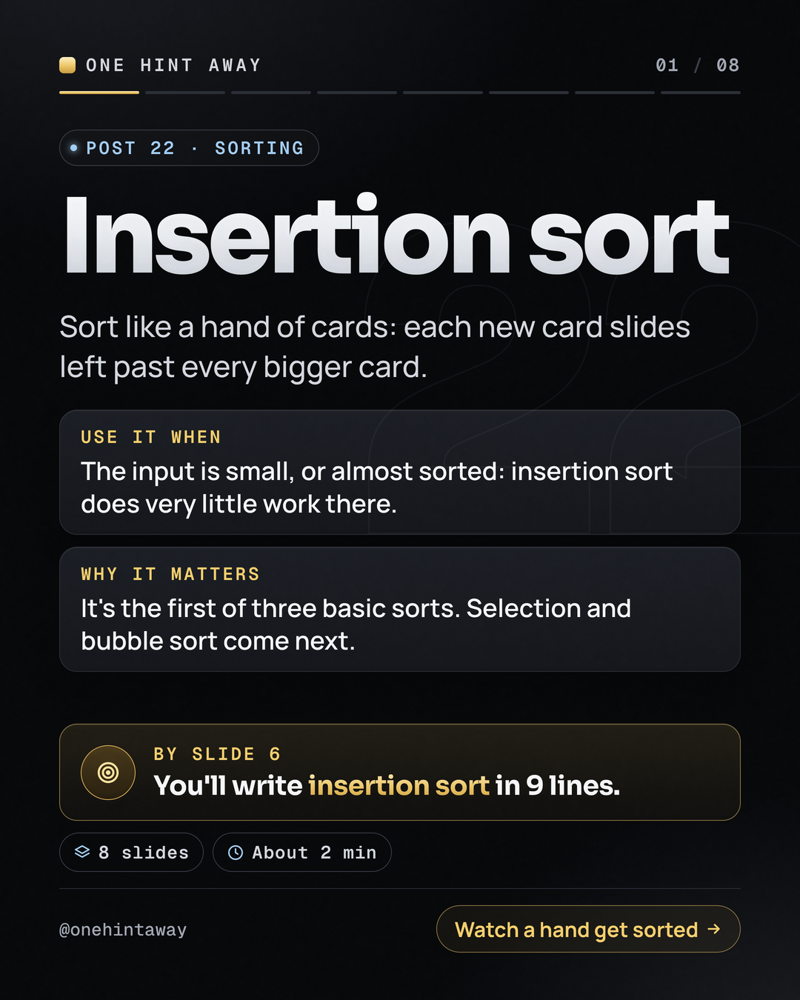
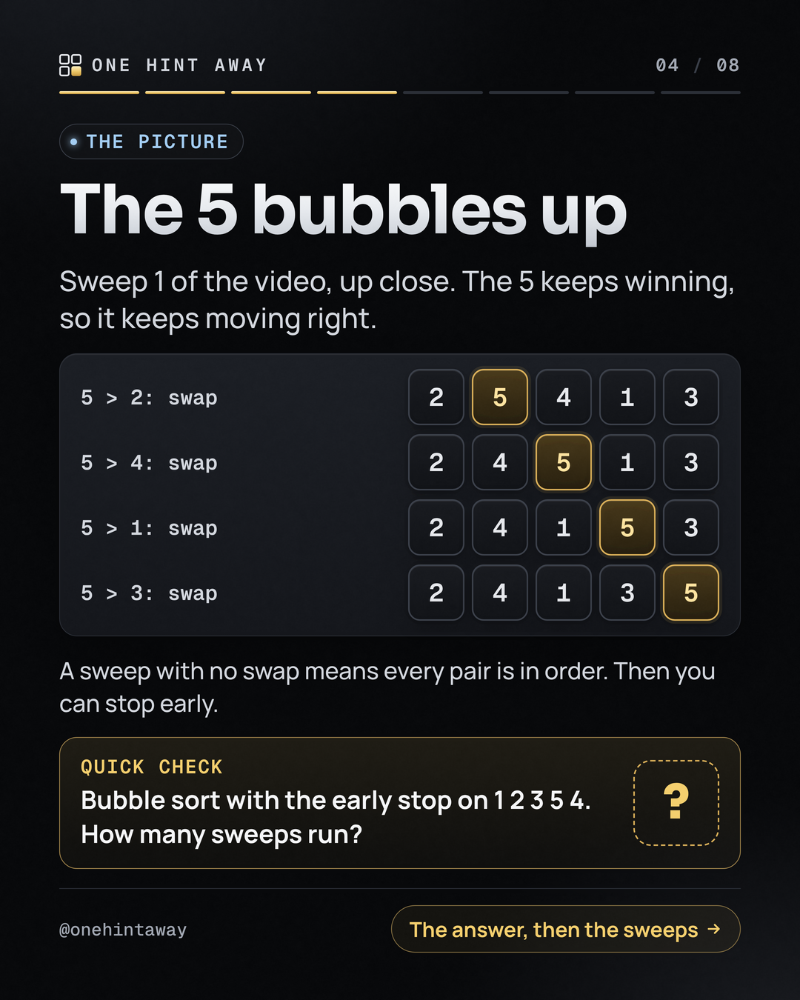
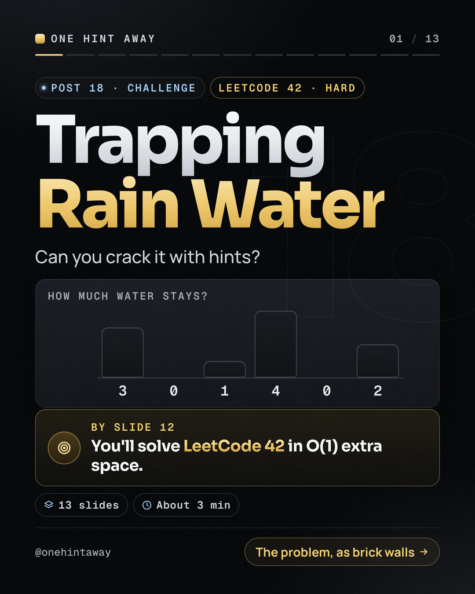
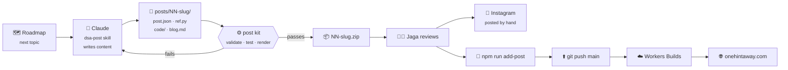
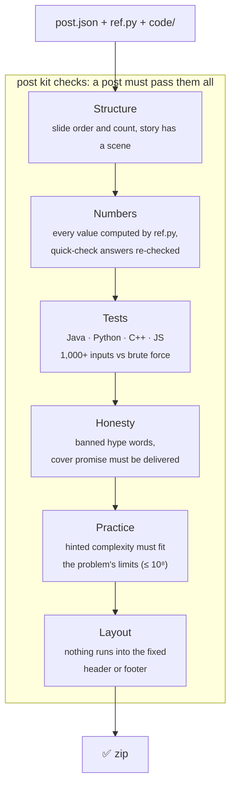
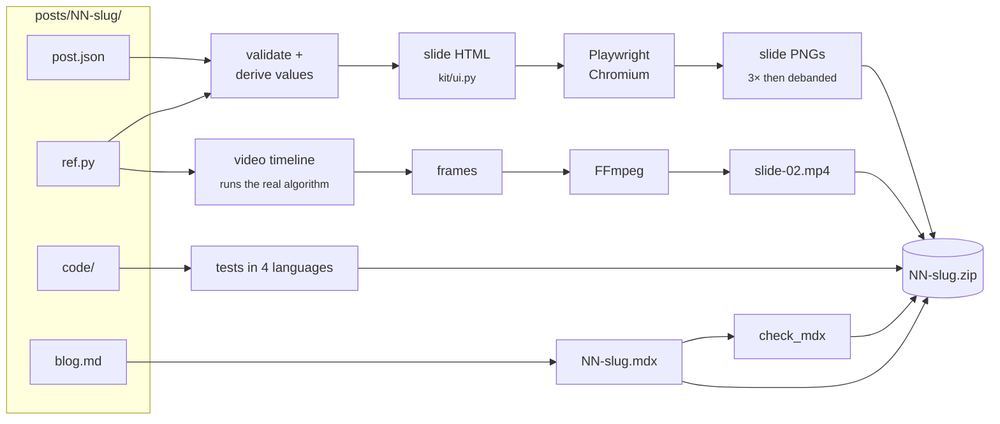

<div align="center">


# One Hint Away

### DSA patterns, one hint at a time.

Daily Instagram carousels and a companion blog that teach data structures and algorithms through a story, a picture, a motion video and pseudocode: **in that order, never code first.**

<br/>

[](https://onehintaway.com)
[](https://www.instagram.com/onehintaway/)


<br/>

&nbsp;
&nbsp;


<sub>Real slides from posts 22, 24 and 18, rendered by the post kit in this repo.</sub>

</div>

<br/>

## ✦ Contents

- [What this is](#-what-this-is)
- [How a post is born](#-how-a-post-is-born)
- [Where AI is used, and where it isn't](#-where-ai-is-used-and-where-it-isnt)
- [Guardrails: why AI mistakes don't reach a slide](#-guardrails-why-ai-mistakes-dont-reach-a-slide)
- [Repository map](#-repository-map)
- [The post kit](#-the-post-kit-post-kit)
- [The blog](#-the-blog-site)
- [Anatomy of a post](#-anatomy-of-a-post)
- [Run it locally](#-run-it-locally)
- [Design system](#-design-system)
- [Roadmap](#-roadmap)

<br/>

## ◆ What this is

One Hint Away is a faceless DSA page for total beginners who swipe fast. Every post teaches **one pattern** with **one tiny example** (five or six values) carried through the whole carousel, and ends with real LeetCode practice.

This monorepo holds the two machines behind it:

| | What it does | Built with |
| --- | --- | --- |
| **`post-kit/`** | Turns one content file per post into finished slides, a motion video, a blog page, a caption and alt text, after testing the post's code in four languages | Python, Playwright, FFmpeg, OpenCV, Node |
| **`site/`** | The blog at [onehintaway.com](https://onehintaway.com): every post as a page with its slides, video, pseudocode and tested code in Java, Python, C++ and JavaScript | Next.js 16, React 19, MDX, Shiki, Cloudflare Workers |

<br/>

## ◆ How a post is born



1. **Plan.** Posts follow a fixed roadmap (Foundations → Arrays and hashing → Maths → Recursion and sorting → Binary search → … → Dynamic programming), ten posts per batch.
2. **Write.** Claude, guided by a custom skill, writes the *content* of each post: the story, the picture, the hints, the pseudocode, the trap, the practice picks, and the reference code.
3. **Build.** The post kit (plain deterministic code, no AI) validates the content, runs every code file against a brute force on 1,000+ inputs, renders the slides and the video, and zips it all.
4. **Review and publish.** Jaga reads a plain-text summary of each post, checks the slides, posts to Instagram himself, and adds the post to the blog with one command. A push to `main` deploys the site.

<br/>

## ◆ Where AI is used, and where it isn't

AI does the drafting. Code does the checking and the rendering. A human decides what goes out.

| Step | Who | Details |
| --- | --- | --- |
| Pick the topic | Roadmap | A fixed, ordered list of patterns; nothing is improvised |
| Story, picture, hints, trap, caption | **Claude** | Written to strict teaching rules: story first, one idea per slide, no jargon before it's explained, no hype in hooks |
| Reference solution, brute force, test inputs | **Claude** | `ref.py`: the solution in Python, a brute force to check it, and the inputs to test with |
| Code in Java, Python, C++, JavaScript | **Claude** | `code/`: LeetCode-style solutions above a test harness |
| Every number on a slide | **Code** | Never typed: each `{{expression}}` in `post.json` is computed by running `ref.py` |
| Testing | **Code** | All four languages run on 1,000+ inputs and must match the brute force |
| Layout, fonts, header, footer, video | **Code** | The kit renders everything; the content file holds no HTML |
| Problem numbers and titles | **Claude + web** | Each practice problem's number, title, URL and difficulty is checked with a web search |
| Approve, post, deploy | **Jaga** | Nothing is published automatically, ever |

<details>
<summary><b>How Claude is guided (the skills)</b></summary>

<br/>

Claude works from two **skills**: versioned instruction files that hold the rules for this project.

- **`dsa-post`**: how to write a post. It covers the slide templates, the teaching rules, the pseudocode style (4-space indents, words not symbols, lines ≤ 44 characters), the honest-hook rule (no "most people", no "easy", no false promises on the cover), how to pick practice problems, and the exact shape of `post.json`, `ref.py` and `blog.md`.
- **`onehintaway-blog`**: how to build and run the site, its deploy steps, and the blog content contract both sides must follow.

A session goes like this: *"make the next 10 posts"* → Claude reads the roadmap, writes ten post folders, runs the kit until every check passes, and sends a plain-text review. Claude never writes slide HTML, video code or layout. The kit owns all of that, so every post looks the same however it was drafted.

</details>

<br/>

## ◆ Guardrails: why AI mistakes don't reach a slide

Language models make confident mistakes. Every rule below exists because one did, or could.



- **No typed numbers.** A slide saying "7 shifts" is really `{{insertion_shifts(EXAMPLE)}}`, so changing the example changes every slide, the video, the caption and the blog page together.
- **The trap is real.** Each post's "common mistake" is run as code: the wrong and the right result shown side by side both come from `ref.py`.
- **Four languages, one truth.** The pseudocode is a line-by-line translation of tested code; the blog shows the same tested code.
- **Visual rules are code too.** Fonts are embedded in every render, the header and footer are pinned, and the render fails if content overlaps them, if text is cut off, or if a box style would hide a value.
- **A human gate.** The kit can say a post is *correct*; only Jaga decides it's *good*.

<br/>

## ◆ Repository map

```text
OneHintAway-Blog/
├── post-kit/                     ⚙️  content → slides, video, blog page, zip
│   ├── render.py                 the one command
│   ├── kit/
│   │   ├── post.py               templates, derived values, validator, review summary
│   │   ├── ui.py                 the design system: header, footer, boxes, bars, code, cards
│   │   ├── video.py              motion slide: timeline → frames → MP4
│   │   └── blog.py               blog MDX + the four-language test runner
│   ├── tools/
│   │   ├── deband.py             removes colour banding from gradients on final export
│   │   └── check_mdx.mjs         checks the blog page against the content contract
│   ├── fonts/                    Sora · Manrope · Geist Mono (SIL OFL), embedded in renders
│   ├── posts/NN-slug/            one folder per post (written by Claude)
│   │   ├── post.json             the slides, caption and blog fields
│   │   ├── ref.py                reference solution, brute force, every number, test inputs
│   │   ├── code/                 Main.java · main.py · main.cpp · main.js
│   │   └── blog.md               the blog page body
│   ├── used_problems.json        practice problems already used, so none repeat
│   ├── viz/<pattern>/ref.py      reference code for the website's visualizer (brute force, 1,000+ inputs)
│   └── README.md                 step-by-step guide to running the kit
│
└── site/                         🌐  onehintaway.com
    ├── app/                      pages: home, posts/[slug], patterns, visualize, about, sitemap, robots
    ├── components/               SlideGallery, CodeTabs, Visualizer, PostList, PatternNav, ThemeToggle …
    ├── content/posts/            one .mdx per post
    ├── public/posts/NN/          each post's slides and video
    ├── lib/
    │   ├── posts.ts              reads every post's frontmatter at build time
    │   ├── sections.ts           roadmap sections, in reading order
    │   ├── remark-code-tabs.mjs  turns four language sections into one tabbed block
    │   └── shiki/                IntelliJ Light theme + a grammar for the pseudocode
    ├── visualizer/               the interactive pattern player's engine
    │   ├── schema.ts             the step format (v1) and the rules every step must obey
    │   ├── patterns/             one pure TypeScript generator per pattern, no DOM
    │   ├── registry.ts           the list the build checks · loaders.ts: one browser chunk per pattern
    │   ├── access.ts             free and paid tiers (the paywall switch, off for now)
    │   └── fixtures/             test inputs and brute-force answers, written by the post kit
    ├── scripts/
    │   ├── add-post.mjs          adds a finished post: MDX in, slides and video in, checked
    │   ├── check-posts.mjs       runs before every build; a drifting post fails the build
    │   └── check-visualizer.mjs  runs before every build; one wrong step fails the build
    └── wrangler.jsonc            Cloudflare: serve out/ as static files
```

<br/>

## ◆ The post kit (`post-kit/`)

One command turns one folder into a finished post.



- **Slides** are HTML built from a small set of parts (boxes, bars, step rows, code blocks, cards), rendered by headless Chromium at 3× and scaled down after a debanding pass, so dark gradients stay smooth on phones.
- **The video** isn't animated by hand. `ref.py` runs the real algorithm and emits a list of states (swap, move, highlight, pointer, caption). The kit tweens between them, captions change as the boxes move, and frames that don't change are reused (often about 40%) before FFmpeg encodes the MP4.
- **The blog page** is generated from `blog.md` with the computed numbers filled in, the pseudocode from the slides, and the four tested code files, then checked against the contract the site enforces.

```bash
# check a post and render review PNGs
python3 post-kit/render.py post-kit/posts/24-bubble-sort --test --png review

# export the finished zip, dated for posting
python3 post-kit/render.py post-kit/posts/24-bubble-sort --export --start 2026-11-09

# a whole batch, one post a day
python3 post-kit/render.py post-kit/posts/2[4-9]-* --export --start 2026-11-07 --daily
```

Full setup (WSL, packages, troubleshooting): **[post-kit/README.md](post-kit/README.md)**.

<br/>

## ◆ The blog (`site/`)

A fully static site: Next.js builds plain HTML, CSS and JS into `out/`, and Cloudflare serves it from its edge with no server and no Worker code.

| Feature | How |
| --- | --- |
| Posts written in MDX | `@next/mdx` with `remark-frontmatter` and `remark-gfm` |
| Code in four languages, one block | `lib/remark-code-tabs.mjs` turns `## Java … ## JavaScript` sections into `<CodeTabs>` |
| Syntax colours with zero client JS | Shiki at build time: VS Code Dark+ for dark mode, IntelliJ Light for light mode |
| Pseudocode highlighted too | A custom TextMate grammar (`lib/shiki/pseudo.tmLanguage.json`) for the series' pseudocode style |
| Slides and video on every post | `SlideGallery` with full-screen view |
| Step through a pattern on your own input | `/visualize/` and a player on matching posts: play, step, scrub, speed, the running pseudocode line, keyboard and screen-reader support. Algorithms run in the reader's browser; no server, no AI |
| A visualizer step can't be wrong | `scripts/check-visualizer.mjs` runs as `prebuild`: every pattern must agree with a Python brute force on 1,000+ inputs, and every step of every input is checked |
| Browse by roadmap or pattern | `lib/sections.ts` order and a patterns index |
| Light and dark themes | `ThemeToggle`, no flash on load |
| SEO | Generated `sitemap.xml` and `robots.txt` |
| A post can't drift from the format | `scripts/check-posts.mjs` runs as `prebuild`: sections, code languages, practice links, file sizes and video sizes are checked, and a bad post fails the build |

```bash
cd site
npm install
npm run dev                                   # http://localhost:3000

npm run add-post -- 24-bubble-sort/24-bubble-sort.mdx 24-bubble-sort/
npm run build                                 # runs check-posts and check-viz first, then builds out/
npm run check-viz -- --sample 50              # quick visualizer check while working
npm run viz-fixtures                          # after changing post-kit/viz/*/ref.py (needs Python)
```

### The pattern visualizer

Readers step through an algorithm on their own numbers at [`/visualize/`](https://onehintaway.com/visualize/): a gallery with one page per pattern, and the same player on any post whose frontmatter says `visualizer: <pattern>`.

| Piece | What it does |
| --- | --- |
| `visualizer/patterns/<id>.ts` | The algorithm as a generator that yields one step at a time: array, pointers, window, stack, named values, one sentence of narration and the pseudocode line. No DOM. |
| `components/VisualizerPlayer.tsx` | Draws any pattern's steps. Motion is CSS transforms only. One-screen layout: input on top, picture left, pseudocode right scrolling in its own box; tabs on phones. |
| `post-kit/viz/<id>/ref.py` | The same algorithm in Python with a brute force and 1,000+ test inputs. `npm run viz-fixtures` saves its answers, so the cloud build never needs Python. |
| `scripts/check-visualizer.mjs` | Fails the build unless TypeScript and Python agree on every input, every step obeys the schema and the pattern's own rules, the example's trace matches step for step, and the pseudocode equals the post's. |

Each pattern ships as its own small chunk (about 2 KB gzipped) beside the player (about 4 KB), loaded only on pages that show one. Patterns today: two pointers, sliding window, monotonic stack. Adding one is two files and two list entries: see [`post-kit/README.md`](post-kit/README.md#website-visualizer-step-by-step).

**Deploy:** a push to `main` triggers **Cloudflare Workers Builds** (root directory `site`), which builds and publishes `out/` to [onehintaway.com](https://onehintaway.com).

<br/>

## ◆ Anatomy of a post

<table>
<tr>
<th width="50%">📘 Concept post · 8 slides</th>
<th width="50%">🧩 Challenge post · 13 slides</th>
</tr>
<tr valign="top">
<td>

1. **Cover**: what you'll be able to do, and by which slide
2. **Video**: the algorithm moving on the tiny example
3. **Story**: an everyday scene that mirrors the idea
4. **Picture** + quick check
5. **Answer** + one more idea on the same numbers
6. **Template**: the pseudocode, highlighted
7. **Trap** + cost: a real beginner bug, wrong vs right
8. **Practice**: one easy and one medium LeetCode problem

</td>
<td>

1. **Cover** and the problem
2. **Story**: the problem as an everyday scene
3. **The real problem** (LeetCode number and example)
4. **Pause**: try it first
5–8. **Hint ladder**: restate → key observation → technique → exact condition
9. **Bridge**
10. **Video**
11–12. **Solution** in pseudocode, with cost
13. **Closing**: the pattern and what to practise next

</td>
</tr>
</table>

Every slide shares one fixed frame: a header with the logo, the slide count and a progress bar, and a footer with the handle and a pill teasing the next slide.

<br/>

## ◆ Run it locally

<details>
<summary><b>Site</b>: Node 22</summary>

```bash
cd site && npm install && npm run dev
```

</details>

<details>
<summary><b>Post kit</b>: WSL / Linux / macOS</summary>

```bash
sudo apt install -y python3 python3-pip ffmpeg nodejs npm default-jdk g++
python3 -m pip install --break-system-packages playwright pillow numpy scipy opencv-python-headless fonttools brotli
python3 -m playwright install --with-deps chromium
(cd post-kit/tools && npm install)

python3 post-kit/render.py post-kit/posts/24-bubble-sort --test --png review
```

The JDK and `g++` are only needed for `--test`. The full step-by-step guide is in [post-kit/README.md](post-kit/README.md).

</details>

<br/>

## ◆ Design system

**Graphite & Chrome**: dark, quiet and readable on a phone in one glance.

| Token | Value | Used for |
| --- | --- | --- |
| Background | `#08090B` with two soft radial glows | every slide |
| Text | `#F5F6F8` · muted `#D3D7DE` · labels `#A2A8B3` | body, leads, labels |
| Gold | `#FFF0C2 → #EBC566 → #C99A3F` | the current pick, the answer, the next-slide pill |
| Steel | `#A3CDF2` | the done or sorted part, section pills |
| Headings | **Sora** 800 / 700 | covers at up to 150 px, titles at 92 px |
| Body | **Manrope** 500–700 | leads, cards, captions |
| Labels and code | **Geist Mono** 500–600 | pseudocode, box values, small caps labels |

Slides are 1080 × 1350 (Instagram 4:5) with 80 px side margins.

<br/>

## ◆ Roadmap

- [x] Post kit: content in, finished post out, tested in four languages
- [x] Blog live at [onehintaway.com](https://onehintaway.com) on Cloudflare Workers static assets
- [x] Posts 00–24 on the blog; batches of ten drafted ahead
- [x] Interactive pattern visualizer: three patterns, checked against a brute force on every build
- [ ] Visualizer: more kinds of picture (decision tree for binary search, moving cells for sorting, grid, linked list, call stack, heap, graph)
- [ ] Post kit: studio-quality pass on slides and video, with the video drawn from the visualizer's step format
- [ ] **API**: Spring Boot 3 (Java 21) + PostgreSQL 16 for search, view counts and sign-ups
- [ ] **Cluster**: k3s with Traefik, cert-manager, Umami analytics, Prometheus and Grafana
- [ ] **CI/CD**: GitHub Actions to test the API, build the image, push to GHCR and roll out

The site never depends on the cluster: if the API is down, every post still loads, and only the extras pause.

<br/>

<div align="center">

<sub>Made by <a href="https://github.com/jagapradeep">Jagapradeep G</a> · content drafted with Claude, checked by code, approved by a human · fonts under the SIL Open Font License</sub>

<br/>

**[onehintaway.com](https://onehintaway.com)** &nbsp;·&nbsp; **[@onehintaway](https://www.instagram.com/onehintaway/)**

</div>
